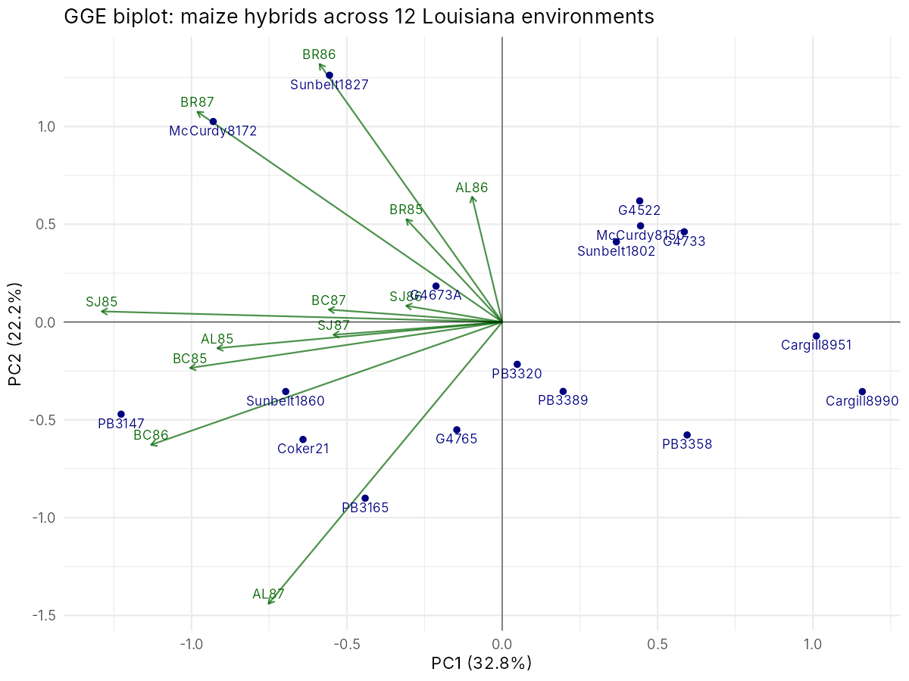

# Variety Trial Analysis: Yield, Stability and G×E in Maize and Rapeseed

[](https://github.com/saphal-sharma/maize-variety-trial-analysis/actions/workflows/tests.yml)

> **Question:** Which hybrids yield well and reliably across environments, and can the rapeseed varieties be told apart?  
> **Answer:** Environment explains 77% of maize yield variation; the top-yielding hybrid was not the most stable. Rapeseed heritability was only 0.08, so the varieties could not be separated reliably.  
> **Method:** ANOVA partition, Finlay–Wilkinson stability, GGE biplot and mixed-model (lme4) heritability in R.




Statistical analysis of multi-environment variety trials (MET), the core data used in plant breeding and seed companies to decide which varieties to release and where to recommend them.

📄 **Report:** [`report/variety_trial_report.md`](report/variety_trial_report.md) · [PDF](report/variety_trial_report.pdf)

## What it does

| Analysis | Question it answers |
|---|---|
| ANOVA partition | How much yield variation comes from variety, environment and their interaction? |
| Finlay–Wilkinson regression | Which hybrids respond to good conditions, and which hold up in poor ones? |
| Wricke's ecovalence | Which hybrids perform most consistently? |
| GGE biplot and which-won-where | Is there one best hybrid, or different winners by location? |
| Linear mixed model, BLUPs and heritability | Can varieties be reliably ranked, and how much of their difference is genetic? |

## Main findings

- **Environment explains 77% of maize yield variation.** G×E explains 17% and hybrid differences only 6%.
- **The top-yielding hybrid (PB3147, 7.9 t/ha) was not the most stable.** G4673A was the most stable but ranked 7th for yield. Eight different hybrids won at least one environment.
- **The rapeseed varieties could not be separated reliably.** Heritability was only 0.08, because variety × environment variance was far larger than the variance between varieties.


## Data

Published trial data distributed with the open-source R package [agridat](https://github.com/kwstat/agridat):

- `kang.maize`: 17 maize hybrids × 12 environments, Louisiana 1985–1987 (Kang & Gorman, 1989, *Agronomy Journal*).
- `shafii.rapeseed`: 6 winter rapeseed varieties × 27 environments × 4 replicates, U.S. National Winter Rapeseed trials (Shafii & Price, 1998, *JABES*).

## How I checked this

- Automated checks rerun the R analysis and confirm the reported findings: environment share of variation (77%), 8 different winning hybrids across 12 environments and rapeseed heritability (0.08).

## Run it

```r
# install.packages(c("dplyr", "tidyr", "ggplot2", "lme4"))
Rscript R/met_analysis.R
```

## Structure

```
data/      trial data (tab-separated)
R/         met_analysis.R
results/   tables (CSV) and charts (PNG)
report/    report (Markdown and PDF)
```

**Author:** Saphal Sharma, M.Sc. student, Sustainable International Agriculture, University of Göttingen
