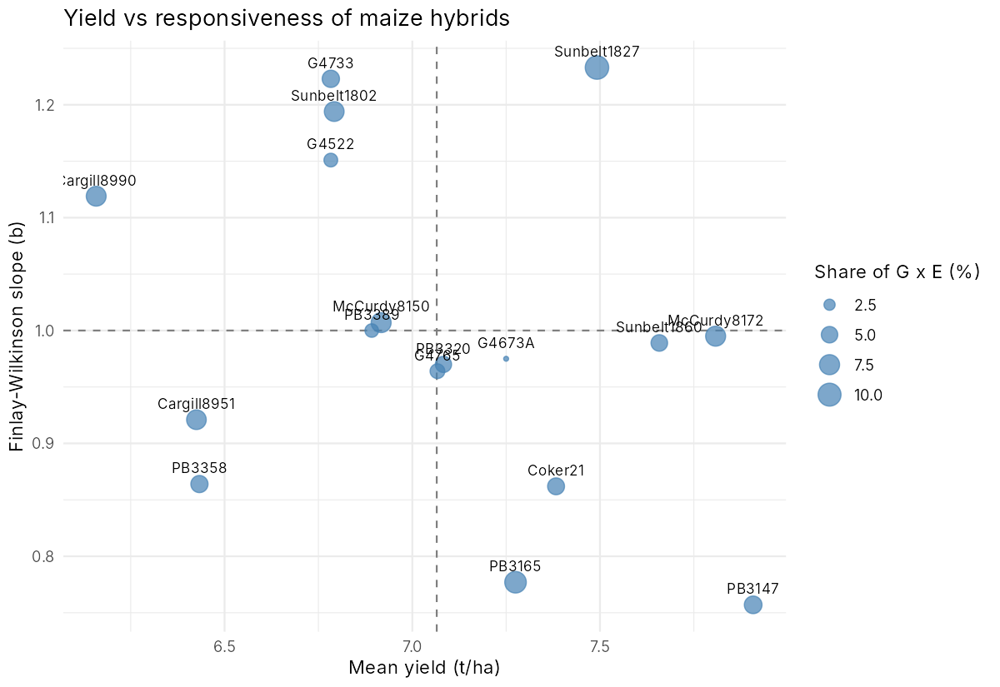
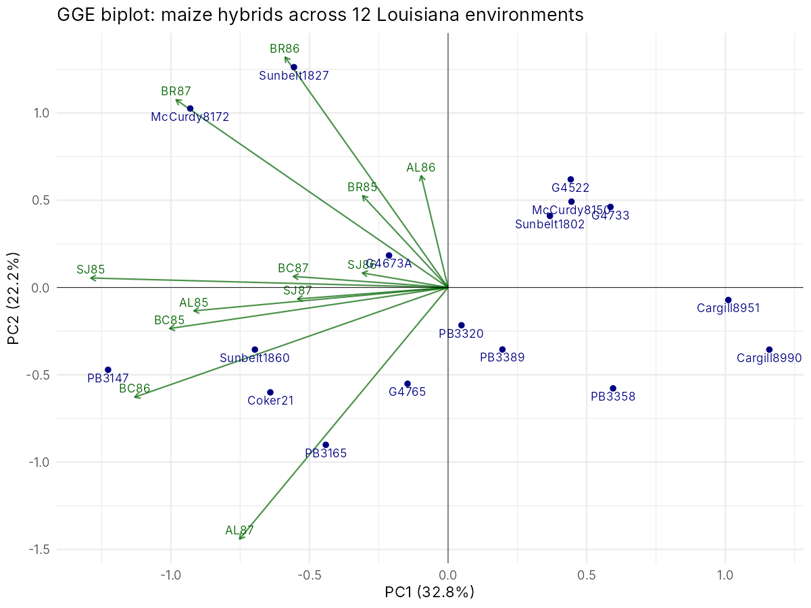

# Summary

Plant breeders and seed companies must decide which varieties to release and where to recommend them, using trials grown in many locations and years. This report analyses two published multi-environment trial (MET) datasets with standard breeding statistics:

- **Maize:** 17 hybrids tested in 12 environments in Louisiana (Kang & Gorman, 1989).
- **Winter rapeseed:** 6 varieties tested in 27 environments with 4 replicates across the United States (Shafii & Price, 1998).

**Main results:**

- **The environment dominates.** It explained 77% of maize yield variation, while hybrid differences explained 6% and genotype-by-environment (G×E) interaction 17%. In rapeseed, the environment explained 83% of variance.
- **The highest-yielding maize hybrid was not the most stable.** PB3147 had the highest mean yield (7.9 t/ha) and won the poorest environment. G4673A was the most stable hybrid but ranked only 7th for yield.
- **Interaction is large relative to hybrid differences.** In maize, G×E was 2.6 times larger than the main hybrid effect, and eight different hybrids won at least one environment.
- **The rapeseed varieties could not be reliably separated.** Variance between varieties was close to zero, so broad-sense heritability on an entry-mean basis was only 0.08. Mixed-model predictions (BLUPs) placed all six within 0.02 t/ha of each other, although raw means differed by 0.22 t/ha.

# 1. Data

**Maize (kang.maize).** Mean yields (t/ha) of 17 commercial hybrids at four Louisiana locations (Alexandria AL, Baton Rouge BR, Bossier City BC, St. Joseph SJ) in 1985–1987. Each trial was a randomised complete block with 4 replicates, but only hybrid means per environment are available.

**Winter rapeseed (shafii.rapeseed).** Plot yields (kg/ha) of 6 varieties from the U.S. National Winter Rapeseed trials, 1987–1989, at 14 locations. Each trial was a randomised complete block with 4 replicates (27 location-year environments, 648 plots).

Both datasets are distributed with the open-source R package *agridat* (Wright, version 1.27).

# 2. Methods

- **ANOVA partition.** A two-way model (yield ~ hybrid + environment) on the maize means. Because there are no replicates, the residual is the G×E interaction.
- **Finlay–Wilkinson regression.** Each hybrid's yield is regressed on the environment mean. A slope b > 1 means the hybrid responds strongly to good conditions; b < 1 means it holds up relatively better in poor conditions.
- **Wricke's ecovalence.** Each hybrid's contribution to the total G×E sum of squares. A low value means stable performance.
- **GGE biplot.** A singular value decomposition of the environment-centred hybrid × environment table, used to visualise which hybrids win where.
- **Linear mixed model (rapeseed).** Yield ~ 1 + (1|variety) + (1|environment) + (1|environment:rep) + (1|variety:environment), fitted with *lme4*. Broad-sense heritability on an entry-mean basis is H² = σ²g / (σ²g + σ²ge/e + σ²ε/(e·r)), with e environments and r replicates.

# 3. Maize results

## 3.1 Sources of variation

| Source | Share of sum of squares |
|---|---|
| Environment | 77.1% |
| G×E interaction | 16.6% |
| Hybrid | 6.3% |

Environment means ranged from 3.2 t/ha (Bossier City 1986) to 9.1 t/ha (Alexandria 1986). Bossier City was the weakest location in all three years.

## 3.2 Yield and stability of hybrids

**Table 1.** Top hybrids by mean yield

| Hybrid | Mean yield (t/ha) | FW slope b | Share of G×E | Stability rank (1 = most stable) |
|---|---|---|---|---|
| PB3147 | 7.91 | 0.76 | 5.7% | 10 |
| McCurdy8172 | 7.81 | 1.00 | 7.4% | 15 |
| Sunbelt1860 | 7.66 | 0.99 | 5.1% | 6 |
| Sunbelt1827 | 7.49 | 1.23 | 10.5% | 17 |
| Coker21 | 7.38 | 0.86 | 5.2% | 7 |
| G4673A | 7.25 | 0.98 | 1.5% | 1 |

- **PB3147** combined the highest mean yield with a low slope (0.76). It did relatively well in poor environments and had the best yield across the three Bossier City trials (6.1 t/ha).
- **Sunbelt1827** was the least stable hybrid. With b = 1.23 it suits high-yield sites, but it is risky in poor seasons.
- **G4673A** was by far the most stable (1.5% of G×E). It is a safe choice where consistency matters more than peak yield.
- **Sunbelt1860** offers a good balance: 3rd for yield, 6th for stability and an average response (b = 0.99).

## 3.3 Which hybrid won where

The first two GGE components explain 55% of the environment-centred variation (PC1 32.8%, PC2 22.2%). Eight hybrids won at least one environment. PB3147, PB3165, McCurdy8172 and Sunbelt1860 won two each, and no hybrid won more than two. This pattern means there is no single best hybrid for all of Louisiana, and that location-specific recommendations could add value.

# 4. Rapeseed results

**Table 2.** Variance components (yield in t/ha)

| Component | Variance | Share |
|---|---|---|
| Environment | 2.065 | 83.4% |
| Residual (plot error) | 0.235 | 9.5% |
| Variety × environment | 0.175 | 7.1% |
| Variety | 0.001 | 0.0% |
| Replicate within environment | 0.000 | 0.0% |

The variance between varieties is almost zero compared with the variety × environment interaction. Heritability on an entry-mean basis is therefore only 0.08, even with 27 environments and 4 replicates. The mixed model shrinks the variety differences strongly: raw means range from 2.27 to 2.49 t/ha, but BLUP predictions range only from 2.36 to 2.38 t/ha. Bienvenu and Glacier rank highest in both.

The practical conclusion is that these six varieties cannot be reliably separated on average yield across this wide range of U.S. environments. Selection should either target specific regions or use additional traits such as winter hardiness or oil content. The replicate-within-environment variance was estimated at zero (a boundary fit), which does not affect the conclusions.

# 5. Implications for variety development and recommendation

1. **Test widely before release.** With the environment explaining around 80% of variation, single-site or single-year results are unreliable.
2. **Report stability next to yield.** A hybrid like G4673A may be the better product for risk-averse farmers, even with a lower mean yield.
3. **Use regional recommendations where G×E is large.** When different varieties win in different locations, region-specific positioning can raise farmers' yields without new genetics.
4. **Use mixed models for ranking.** BLUPs protect against over-interpreting small, noisy differences between varieties.

# References

Kang, M. S., & Gorman, D. P. (1989). Genotype × environment interaction in maize. *Agronomy Journal*, 81, 662–664.

Shafii, B., & Price, W. J. (1998). Analysis of genotype-by-environment interaction using the additive main effects and multiplicative interaction model and stability estimates. *Journal of Agricultural, Biological, and Environmental Statistics*, 3, 335–345.

Wright, K. *agridat: Agricultural Datasets*. R package version 1.27. https://github.com/kwstat/agridat
